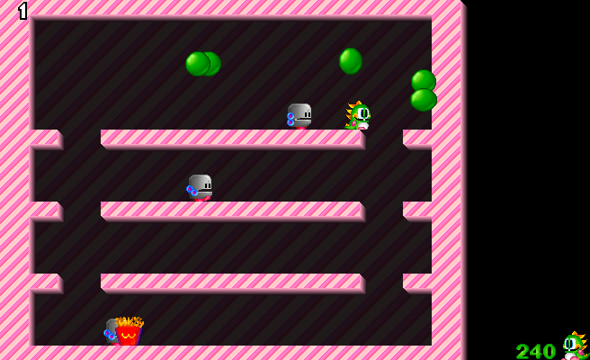

# The Bub's Brothers – developer documentation

The Bub's Brothers (Bub-n-Bros) is a multiplayer clone of Bubble Bobble for
up to 10 players.  These pages describe how the program is built, for
people who want to change the code or make their own levels.



| Page | What it covers |
|---|---|
| [Architecture](architecture.md) | The processes involved (server, clients, web launcher, meta-server), how they talk to each other, and the network protocol |
| [Code layout](code-layout.md) | What lives in which directory and file |
| [How the game engine works](game-engine.md) | The frame loop, generators, sprites, boards, players, monsters, bubbles, bonuses and the potion mini-games |
| [Creating levels](creating-levels.md) | Writing your own level sets, with a worked example in [`examples/TutorialLevels.py`](examples/TutorialLevels.py) |

For installing and running the game see [`../INSTALL.txt`](../INSTALL.txt);
for what changed between versions see [`../CHANGELOG.md`](../CHANGELOG.md).

The diagrams are generated with Graphviz from the sources in
[`diagrams/`](diagrams/):

```bash
cd docs/diagrams && for f in *.dot; do dot -Tpng -Gdpi=110 "$f" -o "../images/${f%.dot}.png"; done
```
