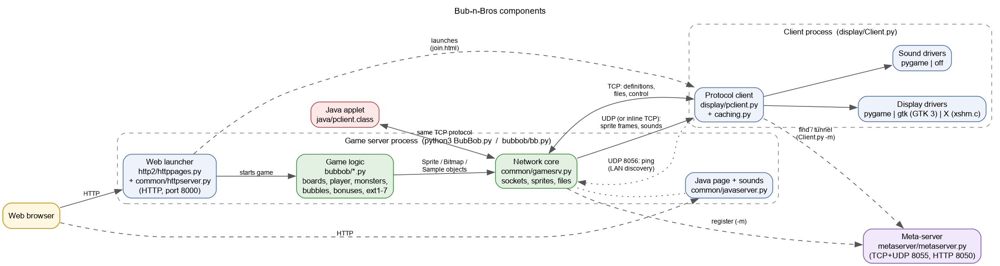
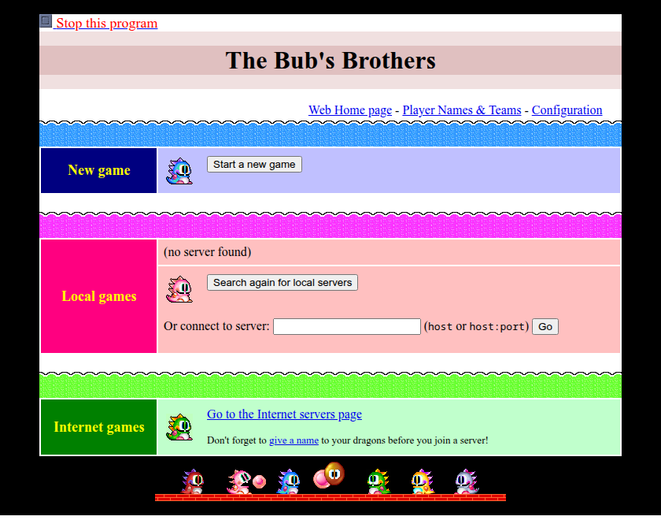

# Architecture

Bub-n-Bros is a client/server game.  All of the game logic runs in **one
server process**; the clients are "dumb terminals" that draw the sprites
the server tells them to draw, play the sounds it asks for, and send back
key presses.  Because nothing game-specific runs on the clients, any number
of people can join from different machines, and the same client can play
any game written for the server framework.



## The processes

### Game server

Started by `bubbob/bb.py` (directly, or through the web launcher).  It is a
single-threaded program built around a `select()` loop in
`common/gamesrv.py`:

* **`common/gamesrv.py`** is a small generic "network game" framework.  It
  knows nothing about Bubble Bobble.  It owns the listening sockets, the
  list of connected clients, and the global list of sprites, and it
  provides the `Bitmap`, `Icon`, `Sample`, `Music` and `Sprite` classes
  that the game uses to describe what should appear on screen.
* **`bubbob/`** is the game itself (boards, dragons, monsters, bubbles,
  bonuses, the seven potion mini-games).  See
  [How the game engine works](game-engine.md).

The server opens several sockets:

| Socket | Default port | Purpose |
|---|---|---|
| TCP game port | random (or `--port LISTEN=n`) | one connection per client: definitions, file transfers, control messages |
| UDP per client | chosen by the client | the stream of sprite frames and sound triggers |
| UDP broadcast | 18000–18999 | optional: one frame broadcast to several clients on the same LAN |
| UDP ping | 8056 | LAN discovery: clients send `pclient-game-ping`, the server answers with its name and ports |
| HTTP | 8000 (or `--port HTTP=n`) | the web launcher pages and the Java applet |

### Web launcher



`BubBob.py` starts a server process in the background (through
`bb.start_metaserver()`, which despite its name starts the local web
pages) and opens a browser on `http://127.0.0.1:8000/<seed>/`.  The pages
are served by `http2/httppages.py` on top of the tiny HTTP server in
`common/httpserver.py`.  From the browser you can:

* start a new game (`new.html`, `run.html`), which creates the game inside
  the same server process;
* look for servers on the LAN and join one (`join.html`), which launches
  `display/Client.py` as a separate process;
* change client options (`options.html`) and player names (`name.html`);
  they are saved in `http2/config.txt` (or `~/.bubnbros` in the Arch
  package).

The HTML templates in `http2/data/` contain `%(...)s` fields that are
**evaluated as Python** by `httpserver.Translator`; multi-line fields are
executed and whatever they `print()` is inserted in the page.

### Clients

`display/Client.py` parses the command line, finds a server (direct
`host:port`, UDP discovery, or the meta-server) and hands the socket to
`display/pclient.py`, the protocol client.  `pclient.Playfield` keeps the
bitmaps, icons and sounds the server has defined, and on each frame tells
the display driver which icon to draw where.

Display drivers (`display/dpy_*.py`) all implement the same small
interface: `pixmap()`, `getppm()`, `putppm()`, `flip()`, `clear()`,
`keyevents()`, `mouseevents()`, `pointermotion()`, `selectlist()` and
`close()`.

| Driver | Module | Notes |
|---|---|---|
| pygame | `dpy_pygame.py` | the usual choice; supports zoom, full screen, alpha |
| gtk | `dpy_gtk.py` | GTK 3 via PyGObject, drawn with cairo; supports zoom |
| X | `dpy_x.py` + `xshm.c` | raw X11 with the shared memory extension; build with `make` |
| windows | `dpy_windows.py` + `windows/wingame.c` | not ported to Python 3 |

Sound drivers (`display/snd_*.py`) are `pygame`, `off`, and the legacy
`linux` and `windows` mixers.

The **Java applet** (`java/pclient.java`) is a separate implementation of
the client.  The server serves it, with a small HTML page, on its HTTP
port (`common/javaserver.py`); it speaks exactly the same protocol.

### Meta-server

`metaserver/metaserver.py` is a directory of public Internet games.
Servers started with `-m` register there; clients started with
`Client.py -m` can list them and connect.  When a direct TCP connection
is impossible (firewalls, NAT), the meta-server relays the set-up messages
so that both sides can try back-connections, simultaneous TCP "SYN"
connections, or a reliable stream tunnelled over UDP
(`metaserver/socketoverudp.py` on top of `metaserver/pipelayer.py`).

## The network protocol

### Message encoding

Every TCP message is built by `common/msgstruct.py`:

```
+--------+----------------+------+-----------------------------+
| n (1B) | n type codes   | type | values packed with struct   |
+--------+----------------+------+-----------------------------+
```

The type codes are `struct` format characters (`B` for small ints, `l` for
other ints, `<len>s` for byte strings), so a message is self-describing:
`message(MSG_DEF_ICON, bmp, ico, x, y, w, h)` and `decodemessage(buffer)`
turn a Python tuple into bytes and back.  The message *type* is one byte;
`MSG_*` constants are server-to-client messages and `CMSG_*` constants are
client-to-server messages.

### Connecting and joining

```mermaid
sequenceDiagram
    participant C as Client (pclient.py)
    participant S as Server (gamesrv.py)
    C->>S: TCP connect
    S->>C: "Welcome to gamesrv.py(3) !\n" + game name + "\n"
    C->>S: CMSG_PROTO_VERSION 3
    S->>C: MSG_DEF_PLAYFIELD width, height, ...
    C->>S: CMSG_ENABLE_SOUND, CMSG_PING
    S->>C: MSG_MD5_FILE / MSG_DEF_BITMAP / MSG_DEF_ICON ... (all graphics)
    S->>C: MSG_DEF_KEY ..., MSG_PLAYER_ICON ..., MSG_PONG
    C->>S: CMSG_UDP_PORT port  (or "\\" = send frames inline over TCP)
    Note over C,S: the client draws the taskbar; the user clicks a dragon and presses 4 keys
    C->>S: CMSG_ADD_PLAYER id, CMSG_PLAYER_NAME id, name
    S->>C: MSG_PLAYER_JOIN id, local=1
    loop every frame
        S-->>C: UDP frame: sounds + list of (x, y, icon)
        C->>S: CMSG_KEY player, key number   (on key press/release)
    end
```

### Files and caching

Bitmaps, sound samples and music are not sent blindly.  The server sends
`MSG_MD5_FILE` with a file id, the file's path (relative to the game
directory), an offset, a length and an MD5 checksum.  The client
(`display/caching.py`) first looks for that file in its own copy of the
game, then in its `cache/` directory; only if neither matches does it send
`CMSG_DATA_REQUEST`, and the server answers with `MSG_ZPATCH_FILE`
(zlib-compressed data).  Clients that run from the same installation as
the server therefore download almost nothing.

Music is streamed the same way, one second ahead, while it plays.

### Frames

Each frame (40 per second by default) the server packs every visible
sprite into 6 bytes, `struct.pack("!hhh", x, y, icon)`, and sends the
concatenation to each client.  Sounds to play are prefixed as 6-byte
records `(sample, left volume, right volume, -1)`.

* With protocol version 3 the frames are compressed with zlib, using three
  rotating compression "threads" with periodic sync points, so that a lost
  UDP packet only spoils a few frames (`Client.setup_dyncompress()` in
  `gamesrv.py`, `Playfield.dynamic_decompress()` in `pclient.py`).
* If too many UDP packets get lost, the client switches to
  "UDP over TCP": frames then arrive as `MSG_INLINE_FRAME` messages on the
  TCP connection.
* The client only redraws what changed: it keeps the previous frame's list
  of sprites and the background under them, and restores/redraws from the
  first difference onwards.

Keys are sent as `CMSG_KEY player, n`, where `n` indexes the server's key
list (`right`, `left`, `jump`, `fire` and their `-` release counterparts,
see `bb.py`).  Because the client only knows key *numbers*, the same
client works for any game.

## Python 3 notes

Version 2.0 is a Python 3 port of the original Python 2 code.  Protocol
data is `bytes` everywhere; `msgstruct.message()` encodes `str` values as
UTF-8 (with `surrogateescape`) and `msgstruct.tostr()` is its exact
inverse.  The wire format did not change, so 2.0 servers and clients can
play with 1.x ones and with the Java applet.
