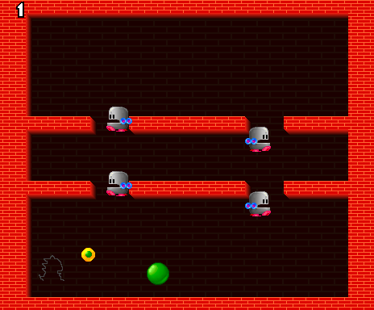
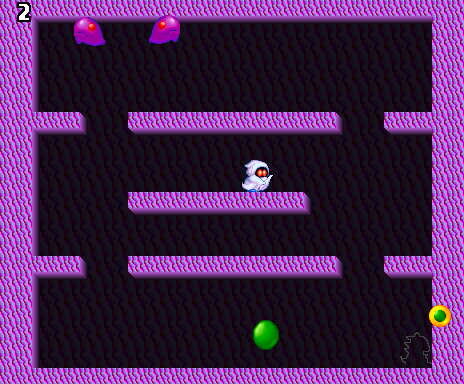
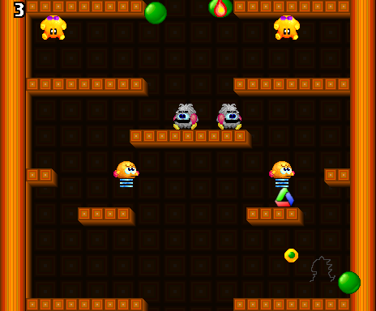

# Creating levels

A **level set** is one Python file in `bubbob/levels/` containing a series
of boards.  Every `.py` (and `.bin`) file in that directory shows up in
the web launcher's "Start a new game" page, and you can also start a
server on any file directly:

```bash
python3 bubbob/bb.py docs/examples/TutorialLevels.py        # from bub-n-bros/
python3 bubbob/bb.py docs/examples/TutorialLevels.py -b 3   # start at board 3
```

then connect a client (`python3 display/Client.py`, or the web launcher's
"Join" link).  The server re-reads the level file at the start of every
board, so you can keep it running while you edit.

This page builds the example level set
[`examples/TutorialLevels.py`](examples/TutorialLevels.py) step by step.

## The file

A level file is ordinary Python.  It starts by importing the level base
class and the monster helpers:

```python
import boarddef
from boarddef import LNasty, LMonky, LGhosty, LFlappy
from boarddef import LSpringy, LOrcy, LGramy, LBlitzy
from boarddef import RNasty, RMonky, RGhosty, RFlappy
from boarddef import RSpringy, ROrcy, RGramy, RBlitzy
```

and then defines one class per board, each derived from `boarddef.Level`.

Rules for the set as a whole:

* **Order.** Boards are played in the alphabetical order of their class
  names, so use names like `level01`, `level02`, ...  (zero-padded!).
* **Same size.** All boards of a set must have exactly the same width and
  height.  Different sets may use different sizes: `CompactLevels.py`
  uses 29×24 cells, `scratch.py` 36×28, the original `.bin` levels 32×25.
* **The final board** must have *no* monsters and its name must sort last
  (`levelFinal` works, because `F` sorts after the digits).  A board
  without monsters is treated as the end-of-game bonus board, so every
  other board needs at least one monster.

## Level 1: walls and monsters



```python
class level01(boarddef.Level):
    a = LNasty      # 'a' cells become a Nasty that starts walking right
    b = RNasty      # 'b' cells become a Nasty that starts walking left

    walls = """
#############################
##                         ##
##                         ##
##                         ##
##                         ##
##                         ##
##                         ##
##                         ##
##       a         b       ##
#######   #########   #######
##                         ##
##                         ##
##                         ##
##       a         b       ##
#######   #########   #######
##                         ##
##                         ##
##                         ##
##                         ##
##                         ##
##                         ##
##                         ##
##                         ##
#############################
"""
```

The `walls` string is the map, one character per 16×16-pixel cell:

| Character | Meaning |
|---|---|
| `#` | wall |
| space | empty |
| any other character | a monster (see below); the cell itself is empty |

Things to keep in mind:

* All lines must have the same length (the game checks this and refuses
  the file otherwise).  Empty lines at the start and end of the string are
  ignored.
* Keep the **two leftmost and two rightmost columns** as walls: they are
  drawn as the thick side borders of the board.
* Dragons and monsters are 2 cells wide and 2 cells high, so leave at
  least 2 empty rows above a platform for anything to stand on it, and
  gaps at least 2 cells wide to jump or fall through.
* Dragons appear in the bottom-left and bottom-right corners, standing on
  the bottom row about 3 cells in from the side walls: keep those spots
  free and the bottom row solid there.

### Monsters

Each letter used in the map must be defined as a class attribute.  The
letter marks the **bottom-left cell** of the monster.  The helpers are
named after the eight monster kinds, with `L` for a monster that starts
walking to the right and `R` for one that starts walking to the left:

| Helper | Monster |
|---|---|
| `LNasty`, `RNasty` | walks and jumps |
| `LMonky`, `RMonky` | walks, throws things |
| `LGhosty`, `RGhosty` | flies |
| `LFlappy`, `RFlappy` | flies, more slowly |
| `LSpringy`, `RSpringy` | jumps on a spring |
| `LOrcy`, `ROrcy` | walks, fast shots |
| `LGramy`, `RGramy` | fast, throws boomerangs |
| `LBlitzy`, `RBlitzy` | fast, shoots straight down |

A letter can stand for several monsters at the same place by giving a
tuple, for example `g = LGhosty, RGhosty`.  The server may add extra
copies of each monster depending on the number of players (or the `-M`
option of `bb.py`).

## Level 2: winds and special bubbles



```python
class level02(boarddef.Level):
    m = RMonky                # Monkies throw things at you
    g = LGhosty, RGhosty      # one letter can stand for several monsters
    letter = 1                # E-X-T-E-N-D letter bubbles may appear

    walls = """
#############################
##                         ##
...
#############################
"""

    winds = """
>>                         <<
>>>>>>>>>>>>xxxxx<<<<<<<<<<<<
>>>>>>>>>>>>xxxxx<<<<<<<<<<<<
>>^^^^^^^^^^^^^^^^^^^^^^^^^<<
...
>>                         <<
"""
```

### Winds

Bubbles do not fly straight: after they have been blown they follow the
**wind map**, a second map of exactly the same size as `walls`:

| Character | Bubbles in this cell move... |
|---|---|
| `>` | right |
| `<` | left |
| `^` | up |
| `v` | down |
| `x` | nowhere: bubbles gather here |
| space | keep going the way they were going |

If you leave `winds` out, `boarddef.Level` builds the usual pattern:
bubbles rise everywhere and collect in a pool in the middle of the top
row, which is what most levels want.  In the example, the top rows push
bubbles from both sides towards the `x` cells.

### Flags

These class attributes switch on extra features of a board:

| Attribute | Effect |
|---|---|
| `letter = 1` | E-X-T-E-N-D letter bubbles appear (collect all six for an extra life) |
| `fire = 1` | fire bubbles appear (popping one drops flames) |
| `water = 1` | water bubbles appear (popping one releases a stream of water that sweeps monsters away) |
| `lightning = 1` | lightning bubbles appear |
| `top = 1` | special bubbles enter from the top instead of the bottom |

Several flags can be set at once: `letter = fire = water = 1`.

## Level 3: holes in the floor



```python
class level03(boarddef.Level):
    f = LFlappy
    s = RSpringy
    o = LOrcy, ROrcy
    fire = water = 1          # fire and water bubbles may appear
    top = 1                   # special bubbles enter from the top

    walls = """
###########       ###########
##                         ##
...
###########       ###########
"""
```

The board wraps around vertically: anything that falls through a gap in
the bottom row comes back in through the top row.  It is usual to leave
gaps in the ceiling at the same places as in the floor, as in this
example.  Special bubbles enter through the
gaps of the bottom row, or of the top row when `top = 1`.

## The final board

```python
class levelFinal(boarddef.Level):

    walls = """
#############################
...
#############################
"""
```

No monsters: this is the board shown at the end of the game, where the
players collect a last shower of bonuses and the scores are ranked.

## Checking a level set

You can check that a file loads without starting a game:

```bash
cd bub-n-bros/bubbob
python3 - <<'EOF'
import sys; sys.path[:0] = ['.', '../common']
import gamesrv
class FakeGame: finalboard = None
gamesrv.game = FakeGame()
d = {}
fn = '../docs/examples/TutorialLevels.py'
exec(compile(open(fn).read(), fn, 'exec'), d)
for name in sorted(d):
    if name.startswith('level'):
        b = d[name](0)
        print(name, b.width, 'x', b.height, len(b.monsters), 'monsters')
EOF
```

which prints

```
level01 29 x 24 4 monsters
level02 29 x 24 3 monsters
level03 29 x 24 6 monsters
levelFinal 29 x 24 0 monsters
```

## Wall graphics

The wall and background images are not part of the level file: board
number *n* of any `.py` set uses the wall pattern of board *n* of the
original game (`bubbob/patmap.py`, images in `bubbob/tmp/`), cycling every
100 boards.  So your level 1 looks red, level 2 purple, and so on.

## Going further

* `CompactLevels.py` (47 boards) and `scratch.py` are complete examples
  of hand-made sets.
* A `.py` level file can contain any Python.  If it defines a function
  `GenerateLevels()`, the game calls it and uses the list of board classes
  it returns: `RandomLevels.py` does this to build a new random set every
  time, using the generator in `levels/rnglevel`.
  `bubbob/save_rnglevel.py` dumps such a random set as an ordinary level
  file you can then edit by hand.
* The `.bin` files are the original MacOS levels; they are read by
  `binboards.py` and cannot be edited with a text editor.
