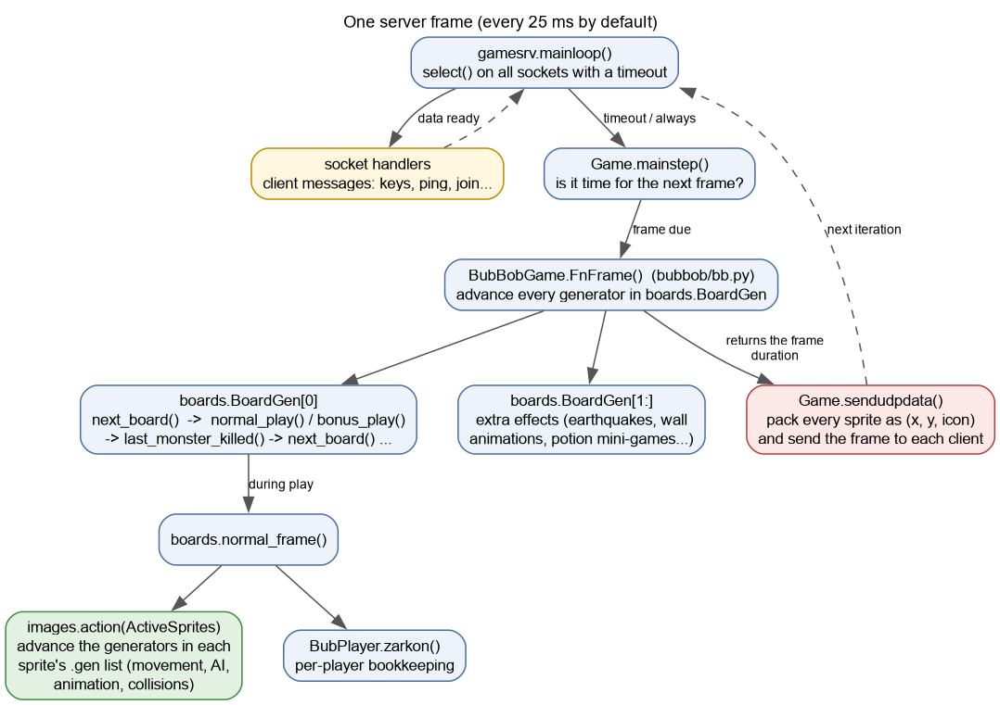
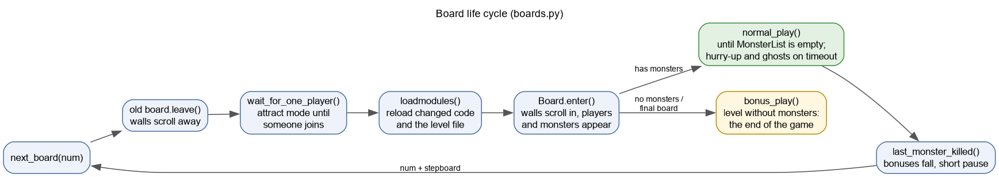

# How the game engine works

All of the game runs on the server, in `bubbob/`, on top of the small
framework in `common/gamesrv.py`.  This page follows one frame through the
code and then looks at each kind of object on the board.

## Coordinates and timing

* The board is a grid of **cells of 16×16 pixels** (`boards.CELL`).  A
  level is `width × height` cells; most sprites (dragons, monsters,
  bubbles, bonuses) are 32×32 pixels, i.e. 2×2 cells.
* Positions are integer pixels with (0, 0) at the top left.  The window is
  9 cells wider than the board: the score board and the player icons live
  on the right.
* One frame lasts `boards.FRAME_TIME` = 25 ms (40 frames per second).
  Bonuses such as the coffee or the clock change the speed by scaling the
  frame time (`boards.set_frametime()`).

## Generators everywhere

The engine is written with **Python generators** instead of state
machines.  Anything that takes more than one frame is a generator that
`yield`s once per frame.  For example, a bonus that falls to the floor:

```python
def faller(self):
    while self.y < boards.bheight:
        if onground_nobottom(self.x, self.y):
            yield None            # resting on a wall: wait one frame
            yield None
        else:
            self.move(self.x, (self.y+4) & ~3)   # fall 4 pixels
        yield None                # end of this frame
    self.kill()                   # fell out of the board
```

There are two levels of generators:

1. **Board generators**, in the list `boards.BoardGen`.  `BoardGen[0]` is
   the "main program" of the game (entering a board, playing it, leaving
   it); the other entries are temporary effects that run in parallel
   (earthquakes, walls flying around, a potion mini-game...).  A board
   generator yields the **duration** of the frame it just produced, as a
   multiple of `FRAME_TIME`.
2. **Sprite generators**.  Every `images.ActiveSprite` has a list `.gen`
   of generators (movement, animation, timeouts...) and an optional list
   `.angry` (extra behaviour of angry monsters).  `images.action()` advances
   all of them once per frame.  `ActiveSprite.setimages(gen)` replaces the
   one generator that is in charge of the sprite's animation.

## One frame



1. `gamesrv.mainloop()` waits in `select()` for network input, with a
   timeout that ends when the next frame is due.  Input from clients is
   handled immediately: a `CMSG_KEY` message calls a method such as
   `BubPlayer.kLeft()` (pressed) or `kmLeft()` (released), which only
   records the key state.
2. `Game.mainstep()` sees that a frame is due and calls
   `BubBobGame.FnFrame()` (`bb.py`), which advances every generator in
   `boards.BoardGen`.
3. During normal play `BoardGen[0]` is `boards.normal_play()`, which calls
   `boards.normal_frame()` each frame:
   * `images.action(images.ActiveSprites[:])` runs the sprite generators.
     This is where dragons move according to the keys, monsters think,
     bubbles float, bonuses fall and collisions are detected.
   * `BubPlayer.zarkon()` handles per-player things such as a dragon that
     needs to (re)appear, and the dragons' hats in team games.
4. `Game.sendudpdata()` encodes the current position and icon of every
   `gamesrv.Sprite` and sends the frame to the clients (see
   [Architecture](architecture.md#frames)).  Sounds requested during the
   frame with `Sample.play()` travel with it.

The game logic never talks to the network directly.  It only creates and
moves `Sprite`s, and the framework sends whatever changed.

## Sprites, icons and images

* `gamesrv.Bitmap` is an image file (a PPM in `bubbob/images/`), sent to
  the clients once.  `Bitmap.geticon(x, y, w, h)` returns an `Icon`, a
  rectangle of that bitmap, also defined once on every client.
* `gamesrv.Sprite(icon, x, y)` puts an icon on the screen.  `move()`,
  `step()`, `seticon()`, `kill()`, `to_front()` and `to_back()` change it.
  The global list `gamesrv.sprites` holds the packed `(x, y, icon)` of
  every sprite in drawing order; that list *is* the frame.
* `images.ActiveSprite` adds the generator lists and collision support.
  `images.touching(x, y, w, h)` returns the touchable sprites in a
  rectangle, using a coarse grid (`images.SpritesByLoc`) that `action()`
  keeps up to date.
* Sprite numbers: `images.sprget(n)` turns a number from
  `sprmap.py`/`mnstrmap.py` into an `Icon`.  Numbers `n + 1000*k` select
  player colour `k`; the coloured images are generated from
  `images/palettes.dat` by `images/buildcolors.py`.  Tuples like
  `('hflip', n)` or `('vflip', n)` give mirrored images.

## Boards

A board is a class derived from `boards.Board` (in practice from
`boarddef.Level`, see [Creating levels](creating-levels.md)) with:

* `walls`: the map, one string per row, `#` for a wall cell;
* `winds`: same size, one character per cell telling bubbles where to
  drift: `<` `>` `^` `v`, `x` (stay) or space (no wind);
* `monsters`: the monsters to create, with their positions and directions;
* flags (`letter`, `fire`, `water`, `lightning`, `top`) controlling which
  special bubbles appear and where from.

`boards.register()` collects the board classes of a level file in name
order into `boards.BoardList`; all boards of a set must have the same
size.  The helpers `bget(x, y)` (wall at a cell), `wget(x, y)` (wind at a
pixel position) and `onground(x, y)` (is a 32-pixel-wide sprite standing
on a wall?) are what moving objects use to interact with the level.

The board's life cycle is a chain of board generators:



* `next_board()` makes the old board leave (its walls scroll up), waits
  until at least one player is connected (showing the attract screen),
  calls `loadmodules()` – which reloads any **changed** source file and
  the level file, so you can edit code or levels while a server runs –
  and creates the new board.
* `Board.enter()` scrolls the new walls in, places the dragons, then
  creates the monsters (`gamesrv.game.f_monsters` multiplies their number,
  by default depending on how many people play).
* `normal_play()` runs until `BubPlayer.MonsterList` is empty.  After a
  while a "hurry up" appears and a monster becomes angry; later still the
  remaining monsters turn into ghosts.
* `last_monster_killed()` lets the fruit fall, waits, and starts
  `next_board()` with the board number plus `stepboard`.
* A board without monsters (the last board of a set, or `--final`) is a
  bonus level: `bonus_play()` shows the end of the game, then
  `game_reset()` restarts if the server runs with `--infinite`.

## Players and dragons

* A `player.BubPlayer` exists for each of the 10 possible players, whether
  connected or not (`BubPlayer.PlayerList`).  It keeps the score, lives,
  E-X-T-E-N-D letters, team, statistics and the current key state.  When
  a client sends `CMSG_ADD_PLAYER`, `gamesrv` calls `playerjoin()`.
* A `player.Dragon` is the sprite a player controls; a player can have
  several dragons at once (some bonuses split you).  Its main generator,
  `Dragon.normal_movements()`, reads the keys every frame and handles
  walking, jumping, falling, blowing bubbles and collisions.
* A dragon's abilities are a dict, `Dragon.dcap` (speed, fire rate,
  gravity, shield, flying, wall breaking, ...).  Most bonuses work by
  changing a value in `dcap`, sometimes only for a limited time
  (`bonuses.TemporaryBonus`).

## Monsters

`monsters.Monster` subclasses differ by a few class attributes: speed
(`vx`, `vy`), whether they fly (`default_mode = Monster.flying`), and what
they shoot (`shootcls`: `MonsterShot`, `FastShot`, `BoomerangShot`,
`DownShot`).  The images come from the classes of the same name in
`mnstrmap.py`.

A monster's generators walk along the walls, jump, and from time to time
turn towards a random dragon (`tagdragon()`).  When a bubble catches it,
the monster is moved into the bubble; when the bubble is popped the
monster dies and drops a bonus whose value grows with the number of
monsters killed at once.

## Bubbles

`bubbles.Bubble` is blown by a dragon, flies horizontally for a moment
and then follows the wind map (`bubble_wind` turns the wind characters
into directions).  Bubbles turn white, then pink, then red before they
burst by themselves.  A dragon pops a bubble by running into it (or can
bounce on it by holding the jump key), and every bubble touching a popped
one pops too, which gives chain reactions.

Special bubbles (`LetterBubble`, `FireBubble`, `WaterBubble`,
`LightningBubble`, and bonus bubbles) enter from the bottom, the top or
the sides depending on the board's `top` flag.  Each class has a
`condition()` (for example "the board has `fire = 1`"), and
`bubbles.newbubble()` picks one at random.

## Bonuses

Every bonus is a class in `bonuses.py` deriving from `Bonus`, with an
image (`nimage`), a number of points and a `taken(dragon)` method.  The
list `bonuses.Classes` (all bonus classes in the module) is where random
bonuses are drawn from; `bigbonus` / `bigdoc` describe the stronger
version that appears in bubbles on bonus levels.  Run
`bubbob/doc/bonus-doc.py` to get an HTML page with a picture and a
description of each one.

A minimal new bonus, added to `bonuses.py`, looks like this:

```python
class Parachute(RandomBonus):
    "Parachute. Fall more slowly."   # the docstring is the bonus description
    nimage = Bonuses.blue_necklace   # any image from mnstrmap.Bonuses
    points = 1000
    def taken(self, dragon):
        dragon.dcap['fly'] += 1      # 'fly' slows down the dragon's falls
```

## Potion mini-games (`ext1` … `ext7`)

The "potion 4" bonus replaces the current board by a mini-game.  Each
`extN` package exposes `min_players` and `run()`; `run()` calls
`boards.replace_boardgen()` with the mini-game's own board generator
(`Arkanoid().bgen()`, `Pacman().bgen()`, ...).  When it ends, the game
resumes with the next normal board.  The mini-games reuse the same sprite
and player machinery, so a new one can be added as an `ext8` package with
the same two names.

## Development tips

* Run a server directly on a level file:
  `python3 bubbob/bb.py bubbob/levels/CompactLevels.py -b 5`
  starts at board 5.  `python3 bubbob/bb.py --help` lists all options.
* The server reloads changed modules and level files at the start of the
  next board, so you usually do not need to restart it.
* When the server crashes it prints the traceback, opens `pdb` (unless it
  runs in the background), and restarts the current board when you leave
  the debugger.
* `localmsg.py` (an optional module on `sys.path`) can set fixed ports or
  a `recordfilename`; recorded games can be replayed with
  `display/playback.py`.
