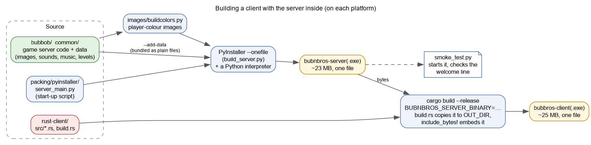
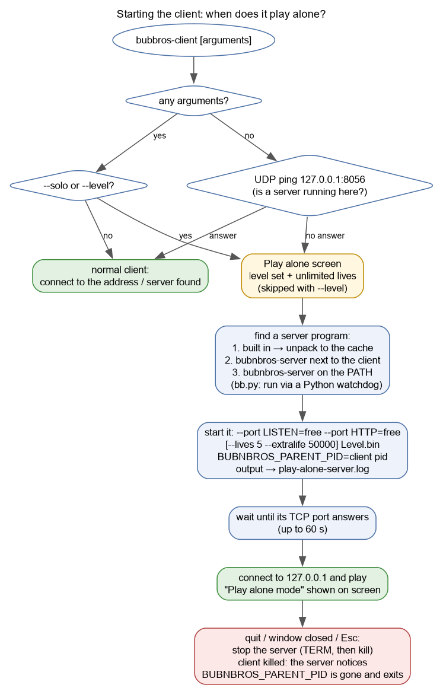

# Play alone: the server inside the native client

Since version 2.4.0 the native client can play without any separate
server.  Started without arguments on a computer where no game server
runs (or with `--solo`), it starts a game server of its own, just for
itself, and stops it when you quit.  The server is not rewritten in Rust:
it is the normal Python game server, packaged with a Python interpreter
and all the game data into one executable, which is in turn embedded in
the client.  So the release binaries are still one file each, and nobody
needs Python installed, on Windows, macOS or Linux.

This page explains how that is built and how it works at run time.  For
how to *use* it, see [`rust-client/README.md`](../rust-client/README.md);
for building it yourself, [Building the native client](building-native-client.md).

## Packaging and bundling



### 1. The server as one executable (PyInstaller)

`packing/pyinstaller/build_server.py` runs
[PyInstaller](https://pyinstaller.org) in `--onefile` mode:

```bash
cd bub-n-bros
python3 -m pip install pyinstaller
python3 packing/pyinstaller/build_server.py
# -> packing/pyinstaller/dist/bubnbros-server   (bubnbros-server.exe on Windows)
```

* **What goes in:** a Python interpreter and the standard library modules
  the game uses, the start-up script `server_main.py`, and the folders
  `bubbob/` and `common/` (plus `http2/`, `display/`, `java/` and
  `metaserver/` for the web launcher, `--web`) **as plain files**
  (`--add-data`).  The game
  loads its modules and level files by path (it puts `bubbob/` and
  `common/` on `sys.path`, `exec`s level files, `__import__`s the
  mini-games by name, reads images and sounds from disk), so it needs
  them as files, not as PyInstaller's frozen modules.  Because of that,
  PyInstaller cannot see which standard modules the game imports;
  `server_main.py` imports them explicitly (`socket`, `zlib`,
  `http.server`, ...) so that they are included.
* **Before packaging,** `build_server.py` runs `images/buildcolors.py`, so
  the player-colour images are already in the bundle.
* **The result** is about 23 MB: one file that contains a small
  bootloader and a compressed archive.  When it runs, the bootloader
  unpacks the archive into a temporary folder (`sys._MEIPASS`, removed
  when it exits) and runs `server_main.py` with the bundled interpreter.
* **`server_main.py`** then starts `bubbob/bb.py` from that folder,
  exactly like `python3 bubbob/bb.py ...` would.  It also makes the
  command line friendlier: a bare level file name (`Arena.bin`) is looked
  up in the bundled `levels/` folder, no level file means `Levels.bin`,
  and `--web` starts the web launcher pages instead of a game.
* **`smoke_test.py`** starts the executable on free ports, checks that it
  answers with the game server's welcome line, and stops it.

PyInstaller only builds for the system it runs on, so this is done on
each platform (by the GitHub workflow for releases).  The game server
code itself is not changed for any of this.

### 2. The server inside the client (`build.rs`, `include_bytes!`)

```bash
cd rust-client
BUBNBROS_SERVER_BINARY=$PWD/../packing/pyinstaller/dist/bubnbros-server \
    cargo build --release
```

* `rust-client/build.rs` runs before the client is compiled.  If the
  environment variable `BUBNBROS_SERVER_BINARY` names a file, it copies
  it to Cargo's `OUT_DIR` and turns on the `embedded_server` setting.
* `src/solo.rs` then contains the whole server executable as a byte
  array: `include_bytes!(concat!(env!("OUT_DIR"), "/embedded-server.bin"))`.
  The client grows from about 1.5 MB to about 25 MB.
* Without the variable (a plain `cargo build`, or the Arch Linux package),
  the array is empty and play alone looks for a server program instead
  (see below).

### 3. Releases (GitHub workflow)

`.github/workflows/rust-client.yml` does all of this on GitHub's Linux,
Windows and macOS machines, for each push that touches the client, the
packaging or the game, and for each `v*` tag:

1. install Python and PyInstaller, build the server, run the smoke test;
2. build the client with `BUBNBROS_SERVER_BINARY` pointing at that server;
3. publish the client with the server inside (`bubbros-play-alone-TARGET`)
   and the server on its own (`bubbros-server-embedded-TARGET`), as
   workflow artifacts and, for tags, as release files, next to
   `bubbros-native-VERSION`, the game for the system's Python.

The Linux packages (Arch, Debian/Ubuntu, RPM) come in the same three
forms, which conflict with each other: `bubbros-native`,
`bubbros-server-embedded` and `bubbros-play-alone`; see INSTALL.txt.

## At run time



### Deciding to play alone

* **With arguments** (an address, `--fullscreen`, ...) the client never
  starts a server, except with `--solo`, or `--level=NAME` (which implies
  `--solo`).
* **Without arguments** it sends a UDP ping to `127.0.0.1:8056`, the
  port on which game servers answer LAN discovery.  If no server answers
  within about two seconds, it plays alone.

### The play alone screen

The window opens with a screen (`src/menu.rs`) to choose the level set
(Levels, Lost Levels, House of Fun, Arena, Compact Levels, Random Levels,
Scratch) and whether lives are unlimited.  If not, the server gets
`--lives 5 --extralife 50000`.  `--level=NAME` and `--unlimited-lives`
skip the screen.

### Finding and starting the server (`src/solo.rs`)

1. **Built in:** the embedded executable is written to the cache folder
   (`~/.cache/bubnbros`, `%LOCALAPPDATA%\bubnbros\cache` or
   `~/Library/Caches/bubnbros`), as `bubnbros-server-<hash>`, where the
   hash identifies this version of it; it is only written once per
   version, and older versions are removed.  It is made executable on
   Linux and macOS.
2. Otherwise a **`bubnbros-server`** program **next to the client**,
3. or **on the PATH**.  If that turns out to be the Python server itself
   (`bubbob/bb.py`, which the Arch Linux package installs as
   `/usr/bin/bubnbros-server`), it is run with `python3` from its own
   folder, through a few lines of Python that do the same parent check as
   `server_main.py` (below).

The client picks two free TCP ports and starts the server hidden (no
console window on Windows), with its output going to
`play-alone-server.log` in the cache folder:

```
bubnbros-server --port LISTEN=<free> --port HTTP=<free> [--lives 5 --extralife 50000] Arena.bin
```

It then tries to connect to the game port every 200 ms, for up to a
minute (the first start of a PyInstaller executable takes a second or
two to unpack), and from there on it is an ordinary client of that
server: the server sends all the graphics, sounds and music as usual.
"Play alone mode" is shown at the top of the window until you join.

### Stopping the server

* **Normal end** (Esc, closing the window, the server going away): the
  client stops the server.  On Linux and macOS it sends `SIGTERM`, which
  the PyInstaller bootloader passes on to the Python process before
  cleaning up its temporary folder, and kills it if it is still running
  three seconds later.  On Windows it ends the whole process tree with
  `taskkill /T /F`.
* **The client is killed or crashes:** the client passes its own process
  id to the server in the `BUBNBROS_PARENT_PID` environment variable.
  `server_main.py` starts a background thread that checks every two
  seconds whether that process still exists (`os.kill(pid, 0)`, or
  `OpenProcess` / `WaitForSingleObject` on Windows) and exits as soon as
  it is gone.  So no forgotten server keeps running.

## Files

| File | Role |
|---|---|
| `packing/pyinstaller/build_server.py` | builds `bubnbros-server` with PyInstaller |
| `packing/pyinstaller/server_main.py` | start-up script inside the executable: runs `bubbob/bb.py`, level name lookup, parent check |
| `packing/pyinstaller/smoke_test.py` | checks that a built server starts and answers |
| `rust-client/build.rs` | embeds the server given by `BUBNBROS_SERVER_BINARY` |
| `rust-client/src/solo.rs` | unpacking, finding, starting and stopping the server |
| `rust-client/src/menu.rs` | the play alone screen |
| `rust-client/src/main.rs` | decides when to play alone |
| `.github/workflows/rust-client.yml` | builds all of it for Linux, Windows and macOS |

## Limitations and notes

* The client carrying the server is about 25 MB instead of 1.5 MB, and
  the first start of play alone takes a moment longer while the server
  is unpacked.
* The server's HTTP port and the LAN discovery port (UDP 8056) are open
  while it runs, like any game server, so other people on the network
  could see and join a play-alone game.
* macOS: the client is not signed, so it must be opened with
  right-click → Open the first time; the server it unpacks itself is not
  affected by this.
